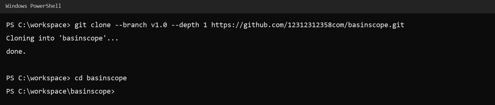
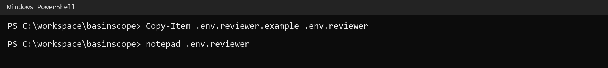
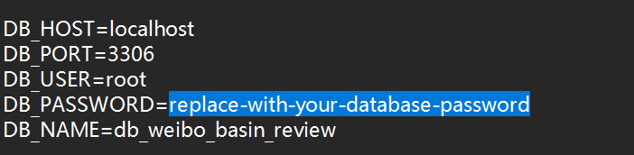
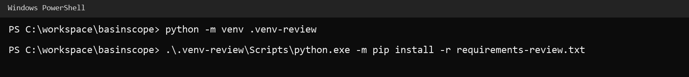

# SOPRAS

SOPRAS is an open-source, configurable Flask software system for multi-source public-opinion analysis and risk screening. Its Yellow River Basin reference configuration demonstrates the workflow using ecological governance, cultural tourism, and healthcare disputes.

## Overview

SOPRAS integrates topic-targeted data acquisition, de-identified storage, Chinese-language text analytics, event monitoring, rule-based risk screening, cross-platform comment clustering, interactive visualization, and short-video analysis.

Main features:

- Configurable platform connectors and topic/event dictionaries.
- jieba segmentation and SnowNLP-based sentiment analysis.
- TF-IDF and K-means comment clustering.
- Event, province, interaction, and risk-screening views.
- A synthetic reviewer dataset for reproducible interface testing.

## Repository Structure

```text
app.py                 Application launcher
src/                   Flask app, analytics, storage, and frontend code
scripts/               Reviewer utilities and demo initialization
sql/                   Database schema and synthetic demo data
docs/                  Architecture, methods, setup, and reproducibility
requirements*.txt     Dependency files
```

## Requirements

- Windows 10 or 11
- [Python 3.10 or later](https://www.python.org/downloads/windows/)
- [MySQL 8.0 or later](https://dev.mysql.com/downloads/installer/)
- [Git for Windows](https://git-scm.com/download/win)

## Quick Start (MySQL)

The `v1.0` tag corresponds to the submitted manuscript.

### 1. Clone the repository

```powershell
git clone --branch v1.0 --depth 1 https://github.com/12312312358com/basinscope.git
cd basinscope
```

Example terminal session:



The `detached HEAD` message is expected when checking out the annotated `v1.0` tag.

### 2. Configure the reviewer database

Create the reviewer environment file:

```powershell
Copy-Item .env.reviewer.example .env.reviewer
```

Change only `DB_PASSWORD` in `.env.reviewer`:

```powershell
notepad .env.reviewer
```



For example:

```text
DB_PASSWORD=your-mysql-password
```



Keep the other values unchanged, save the file, and close Notepad. Do not create a `.env` file for this reviewer setup.

### 3. Install dependencies

```powershell
python -m venv .venv-review
.\.venv-review\Scripts\python.exe -m pip install -r requirements-review.txt
```



### 4. Initialize the reviewer database

```powershell
.\.venv-review\Scripts\python.exe scripts/init_demo_db.py
```

Successful initialization ends with output similar to:

```text
Review database ready: db_weibo_basin_review
t_basin_article=2430, t_basin_comment=140
```

### 5. Start the application

```powershell
.\.venv-review\Scripts\python.exe app.py
```

Open:

```text
http://127.0.0.1:5001/page/dashboard
```

### 6. Verify the installation

Open:

```text
http://127.0.0.1:5001/healthz
http://127.0.0.1:5001/readyz
```

The expected `/readyz` response includes:

```json
{
  "article_count": 1097,
  "comment_count": 59,
  "database": "ok",
  "scope": "yellow-river",
  "status": "ok",
  "tables": 13
}
```

If MySQL reports `Access denied`, check `DB_PASSWORD` in `.env.reviewer`. If port `5001` is already in use, change `PORT` in `.env.reviewer` and use the corresponding URL.

## Data Availability

The repository provides the database schema and a synthetic reviewer dataset only. Raw platform records cannot be redistributed because of platform terms, privacy requirements, and data-use restrictions. The synthetic data are provided solely to verify installation, database setup, dashboard rendering, and the 17 analysis views; they do not reproduce the manuscript's empirical estimates.

## Documentation

- [Full application setup](docs/FULL_SETUP.md)
- [Architecture](docs/ARCHITECTURE.md)
- [Data setup](docs/DATA_SETUP.md)
- [Methods](docs/METHODS.md)
- [Reproducibility](docs/REPRODUCIBILITY.md)
- [SoftwareX metadata](docs/SOFTWARE_METADATA.md)

## Citation

See [CITATION.cff](CITATION.cff) for citation metadata.

## License

MIT License. See [LICENSE.txt](LICENSE.txt).

## Contact

Maintainer: Wujun Long

Email: 2715469798@qq.com
