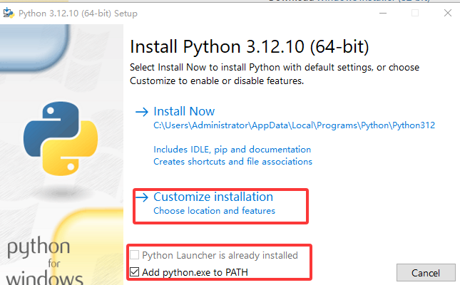
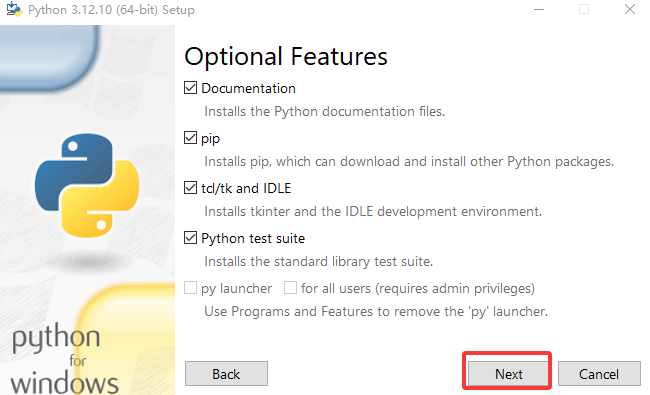
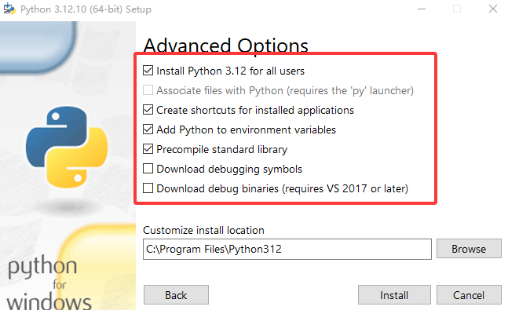

# Python Installation Guide (Windows)

Download the Python 3.12.10 Windows x64 installer:

```text
https://mirrors.aliyun.com/python-release/windows/python-3.12.10-amd64.exe
```

Run the downloaded installer and follow the three screenshots below. Select **Add python.exe to PATH**, keep the installation options shown, and click **Install**.





